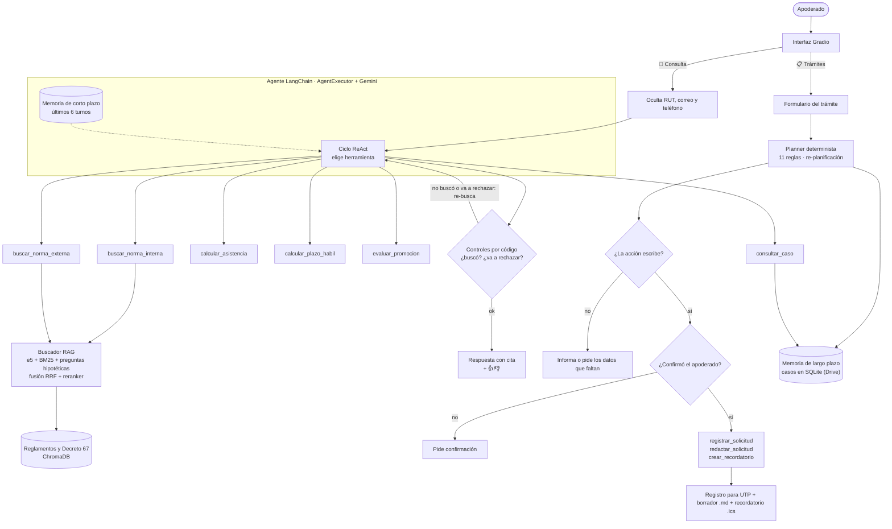
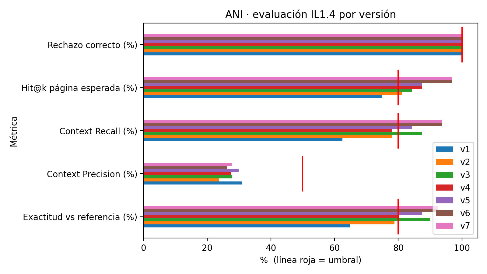

<p align="center">
  
</p>

# ANI · Asistente Normativo Institucional

Agente de IA que acompaña a apoderados y apoderadas del **Liceo Polivalente Guillermo Labarca Hubertson** en dos tareas:

1. **Responder dudas** sobre el *Reglamento de Evaluación y Promoción 2026*, el *Reglamento Interno de Convivencia Escolar 2026* y el *Decreto 67/2018 (MINEDUC)*. Cada respuesta cita el **documento, la ubicación (título, punto, protocolo o artículo) y la página**. Si algo no está en los documentos, ANI lo dice en vez de inventarlo.
2. **Gestionar tres trámites**: reprogramación de una evaluación, situación de promoción y reclamo por plazo de entrega de notas. ANI decide qué corresponde según el reglamento, calcula el plazo en días hábiles y, **solo si el apoderado confirma**, registra la solicitud para UTP, genera un borrador formal y crea un recordatorio para el calendario. Con un código de caso, el trámite se puede retomar otro día.

> Proyecto de la asignatura **ISY0101 · Ingeniería de Soluciones con IA** (DUOC UC), desarrollado por **Felipe Villalobos** y **Adolfo Medina**. La EP1 construyó el asistente de consultas (v1 → v7). La EP2 lo convirtió en un agente con LangChain que también hace trámites (v8).

---

## Cómo ejecutarlo

[](https://colab.research.google.com/github/felipits/ANI-asistente-normativo/blob/main/notebooks/P6_ANI_agente_v8.ipynb)

1. **Copia la carpeta [`ANI/`](ANI/) de este repositorio a tu Google Drive.** Tiene que llamarse `ANI` y puede ir en cualquier lugar dentro de *Mi unidad*. Debe contener los documentos (`.pdf` o `.md`), `ANI_preguntas_hipoteticas.json`, `ANI_set_preguntas_prueba.xlsx` y los dos logos. Si un documento está en `.md` y en `.pdf`, ANI usa el `.md`.
2. Haz clic en **Abrir en Colab** (arriba).
3. **Entorno de ejecución → Cambiar tipo de entorno de ejecución → T4 GPU → Guardar.** Sin GPU funciona, pero cada respuesta tarda más.
4. Crea una clave gratuita de Gemini en [Google AI Studio](https://aistudio.google.com/apikey) y guárdala en el ícono 🔑 *Secretos* de Colab con el nombre `GEMINI_API_KEY`, con *Acceso al notebook* activado.
5. Haz clic en la celda **9 · Evaluación** y elige **Entorno de ejecución → Ejecutar anteriores**. Esto prepara ANI sin gastar cuota de evaluación. Acepta el acceso a Google Drive cuando Colab lo pida. Si Colab pide reiniciar la sesión después de la celda 1, reinicia y vuelve a ejecutar.
6. La celda **6b** muestra las pruebas automáticas (`11/11 pruebas pasaron`) y la celda **7** entrega un link `…gradio.live` con la interfaz, que funciona mientras Colab esté abierto.

**Ojo:** *Ejecutar todas* también corre la evaluación (celdas 9 y 10), que hace 40 preguntas y las corrige con un juez LLM. Tarda unos 30 a 40 minutos y gasta cuota de Gemini. Si se corta por cuota o saturación, al volver a ejecutar retoma donde quedó. Si no quieres ejecutarlo, los notebooks muestran sus salidas directamente en GitHub.

La memoria de casos (`ani_memoria.db`) se crea sola en tu carpeta `ANI` la primera vez.

## Arquitectura

ANI tiene dos flujos que comparten la interfaz y la memoria de largo plazo:

- **💬 Consulta:** un agente con LLM entiende la pregunta, elige herramientas y responde con citas.
- **📋 Trámites:** un planner determinista decide con las reglas del reglamento y solo escribe después de la confirmación del apoderado.



| Componente | Implementación |
|---|---|
| Fragmentación | PDF (PyMuPDF) o Markdown, por sección, artículo, punto o protocolo. Fragmentos de 800 caracteres con solape de 150 y su **página exacta** (1.142 fragmentos) |
| Preguntas hipotéticas | *doc2query*: 3 preguntas tipo apoderado por fragmento (3.057 en total), generadas una vez con Gemini |
| Recuperación | Multi-consulta + búsqueda híbrida: semántica (`multilingual-e5-small` + ChromaDB), léxica (BM25) y preguntas hipotéticas, con fusión RRF, reranker `mmarco-mMiniLMv2-L12`, anti-duplicados y contexto ampliado a la sección |
| Agente | LangChain (`AgentExecutor` + `create_tool_calling_agent`) con Gemini (`gemini-3.1-flash-lite` y dos modelos de respaldo ante saturación o cuota) |
| Memoria de corto plazo | Ventana con los últimos 6 turnos de la conversación |
| Memoria de largo plazo | Casos en SQLite dentro de Drive, identificados por un código (`C-4E9B52`), sin RUT ni login, y borrados a los 60 días sin movimiento |
| Trámites | Planner de 11 reglas en orden de prioridad, re-planificación cuando cambian los datos y confirmación humana antes de escribir |
| Controles | Búsqueda obligatoria, re-búsqueda antes de responder "no está regulado", ocultamiento de datos personales y panel de trazabilidad |
| Interfaz | Gradio con dos pestañas: 💬 Consulta (chat, fuentes desplegables, preguntas frecuentes y 👍/👎 con comentario) y 📋 Trámites (formulario, confirmación, descargas y retomar caso) |

### Herramientas

| Tipo | Herramienta | Qué hace | La usa |
|---|---|---|---|
| Consulta | `buscar_norma_interna` | Busca en los reglamentos del liceo (evaluación o convivencia) | Agente |
| Consulta | `buscar_norma_externa` | Busca en el Decreto 67/2018 | Agente |
| Consulta | `consultar_caso` | Recupera un trámite guardado por su código | Agente |
| Razonamiento | `calcular_asistencia` | Calcula el % de asistencia y lo compara con el 85 % | Agente |
| Razonamiento | `calcular_plazo_habil` | Suma días hábiles, descontando fines de semana y feriados de Chile | Agente |
| Razonamiento | `evaluar_promocion` | Aplica el Art. 10 (promedio 4,5 con 1 reprobada, 5,0 con 2, asistencia 85 %) | Agente |
| Escritura | `registrar_solicitud` | Agrega la solicitud al registro de la unidad con ID `ANI-2026-0001` y estado "pendiente" | Flujo de trámites |
| Escritura | `redactar_solicitud` | Genera un borrador formal en Markdown con la norma citada y campos para completar fuera de ANI | Flujo de trámites |
| Escritura | `crear_recordatorio` | Genera un archivo `.ics` con el plazo, que se abre en cualquier calendario | Flujo de trámites |

Las herramientas de cálculo hacen la operación en Python, no en el modelo. Las de escritura rechazan el texto si detectan un RUT, un correo o un teléfono, y **el agente LLM no tiene acceso a ellas**: solo las ejecuta el flujo de trámites, después de la confirmación.

### Reglas del planner de trámites

Se evalúan en orden y el planner se detiene en la primera que se cumple.

| # | Si… | ANI hace | ¿Escribe? | Fuente |
|---|---|---|---|---|
| 1 | Es una situación de convivencia | Deriva a Convivencia Escolar | Sí | — |
| 2 | No es un trámite | Lo responde el agente en el chat | No | — |
| 3 | Faltan datos | Pregunta lo que falta | No | — |
| 4 | Faltó a una prueba sin justificación | Explica que la reprogramación exige justificación | No | Reglamento de Evaluación, Art. 5 |
| 5 | Justificó, pero pasaron más de 5 días hábiles | Deriva a UTP | Sí | Reglamento de Convivencia, pág. 23 |
| 6 | Justificó a tiempo | Prepara la solicitud de reprogramación | Sí | Reglamento de Evaluación, Art. 5 |
| 7 | Cumple notas y asistencia | Informa que pasa de curso | No | Reglamento de Evaluación, Art. 10 |
| 8 | No cumple por notas | Deriva a análisis de UTP | Sí | Art. 10 y 11 |
| 9 | No cumple solo por asistencia | Prepara la solicitud a Dirección y UTP | Sí | Art. 10, 2) d) |
| 10 | Pasaron más de 10 días hábiles sin notas | Prepara el reclamo a UTP | Sí | Reglamento de Evaluación, pág. 9 |
| 11 | Las notas están dentro del plazo | Informa cuántos días van | No | Reglamento de Evaluación, pág. 9 |

Los umbrales (85 %, 4,5, 5,0, 5 y 10 días hábiles) están definidos una sola vez en la celda 1, con el artículo de donde salen.

## Ejemplos de flujo

**Consulta con memoria de corto plazo**
1. *"Mi hijo ha ido 150 de 180 días de clases. ¿Repite?"* → el agente usa `calcular_asistencia` (83,3 %) y busca en el reglamento y en el decreto. Responde que está bajo el 85 % y que la promoción la resuelven Dirección y UTP, con las citas.
2. *"¿Y si fueron 160 días?"* → entiende que es la misma situación sin que se repita (88,9 %, cumple).

**Trámite con confirmación y re-planificación**
1. Reprogramación, inasistencia del 04-11-2026, con certificado → **Evaluar** → `solicitar_reprogramacion` y plazo calculado en días hábiles. ANI pide confirmación.
2. **Confirmar y registrar** → registro `ANI-2026-0002`, borrador de solicitud para UTP y recordatorio `.ics`, listos para descargar, más un código de caso.
3. Si la fecha se corrige al 13-10-2026 → **Evaluar** → ANI re-planifica: `solicitar_reprogramacion` → `derivar_utp_fuera_de_plazo`, porque ya pasaron más de 5 días hábiles.
4. Otro día, con el código de caso → **Retomar caso** → ANI recupera el trámite, la última acción y el plazo.

**Planificación de promoción:** con 150 de 180 días y sin asignaturas reprobadas la acción es `solicitar_promocion_excepcional`. Si el apoderado corrige a 160 días, ANI re-planifica y pasa a `informar_promocion`.

## Pruebas

La celda **6b** corre 11 pruebas automáticas que no gastan cuota de Gemini. Usan una base temporal, así que no tocan la memoria real, y fechas fijas, así que dan lo mismo cualquier día. Resultado: **11/11** ([`evidencia/pruebas.txt`](evidencia/pruebas.txt)).

| Prueba | Qué verifica |
|---|---|
| `test_convivencia_va_primero` | La regla de convivencia gana aunque también sea un trámite |
| `test_falta_dato_pide_info` | Si falta un dato, pide información en vez de decidir |
| `test_reprogramacion_justificada_escribe` | La reprogramación justificada a tiempo es una acción que escribe |
| `test_replanifica_si_falto_hace_semanas` | Cambia de plan si la inasistencia quedó fuera de plazo |
| `test_replanifica_si_corrige_asistencia` | Cambia de plan si se corrige la asistencia (150 → 160 días) |
| `test_notas_fuera_de_plazo` | Prepara el reclamo si pasaron más de 10 días hábiles |
| `test_plazo_salta_feriados` | El plazo salta el 18 y 19 de septiembre |
| `test_no_escribe_sin_confirmacion` | Sin confirmación no se genera ningún archivo ni registro |
| `test_confirmado_escribe_y_guarda_caso` | Con confirmación se generan el registro, el borrador y el recordatorio, y se guarda el caso |
| `test_escritura_rechaza_rut` | El registro rechaza un texto con RUT |
| `test_memoria_corto_plazo_ventana` | La memoria de corto plazo corta en 6 turnos |

## Iteraciones

| Notebook | Autor | Versión | Cambio principal |
|---|---|---|---|
| [P1](notebooks/P1_prototipo_agente.ipynb) | Felipe | v1 | Prototipo: fragmentos, ChromaDB, agente con 4 herramientas e interfaz Gradio |
| [P2](notebooks/P2_evaluacion_IL14.ipynb) | Adolfo | (mide v1) | Evaluación automática con 40 preguntas y juez LLM (criterios IL1.4) |
| [P3a](notebooks/P3a_mejoras_recuperacion_v2_v3.ipynb) | Felipe | v2 – v3 | Búsqueda híbrida, multi-consulta, reranker, re-búsqueda antes de rechazar, interfaz final |
| [P3b](notebooks/P3b_notebook_limpio_v4_v5.ipynb) | Felipe | v4 – v5 | Notebook limpio + ajuste léxico (caso "atrasos") |
| [P4](notebooks/P4_paginas_exactas_doc2query_v6.ipynb) | Adolfo | v6 | Páginas exactas, preguntas hipotéticas, anti-duplicados y contexto ampliado |
| [P5](notebooks/P5_ANI_final.ipynb) | Felipe y Adolfo | v7 | Versión final de la EP1: etiqueta de protocolos corregida y medición con GPU |
| [P6](notebooks/P6_ANI_agente_v8.ipynb) | Felipe y Adolfo | v8 | EP2: agente con LangChain, memoria de largo plazo, planner de trámites, herramientas de escritura y pruebas automáticas |

El detalle de cada iteración, con el diagnóstico que motivó cada cambio, está en **[docs/BITACORA.md](docs/BITACORA.md)**.

## Resultados

Evaluación con 40 preguntas (32 con respuesta en los documentos y 8 que deben rechazarse), usando un LLM juez a temperatura 0. La v8 se volvió a medir para comprobar que la migración a LangChain no bajara la calidad de las respuestas.

| Métrica | Umbral | v1 | v2 | v3 | v4 | v5 | v6 | v7 | v8 |
|---|---|---|---|---|---|---|---|---|---|
| Exactitud vs referencia (%) | 80 | 65,0 | 78,8 | 90,0 | 80,0 | 87,5 | 92,5 | 92,5 | **97,5** |
| Fidelidad (/10) | 8 | 7,6 | 9,6 | 9,8 | 9,4 | 9,8 | 9,8 | 9,8 | **9,8** |
| Relevancia (/10) | 8 | 8,9 | 9,3 | 9,6 | 9,4 | 9,6 | 9,7 | 9,7 | **9,8** |
| Context Precision (%) | 50 | 30,8 | 23,7 | 27,8 | 27,5 | 29,9 | 26,2 | 27,7 | **31,7** |
| Context Recall (%) | 80 | 62,5 | 78,1 | 87,5 | 78,1 | 84,4 | 93,8 | 93,8 | **96,9** |
| Hit@k página esperada (%) | 80 | 75,0 | 81,2 | 84,4 | 87,5 | 87,5 | 96,9 | 96,9 | **96,9** |
| Rechazo correcto (%) | 100 | 100 | 100 | 100 | 100 | 100 | 100 | 100 | **100** |

**Cita correcta** (documento y página): v7 96,9 % (31/32) y v8 93,8 % (30/32).

**Casos pendientes en v8:**
- **#23** (máximo de días de suspensión): la respuesta es correcta, pero la cita no.
- **#37** (qué vale si el reglamento choca con el decreto): la recuperación no trae el fragmento completo, e inventa un artículo.
- **#28** (preuniversitario): el rechazo es correcto, pero agrega una sugerencia que el juez considera de más.

**Context Precision** queda bajo el umbral en todas las versiones porque el buscador entrega varios fragmentos para asegurar que el dato llegue (recall). En P3a (Paso 21) se simuló un corte por puntaje del reranker y ningún corte llegó a 50 % sin perder recall, así que se priorizó no omitir información.

**Latencia:** la v8 se midió sin GPU (mediana de 28,4 s por respuesta), así que no se compara con la v7, que se midió con GPU T4 (19,2 s).



Los archivos de cada medición están en [`evaluacion/`](evaluacion/) y el set de 40 preguntas en [`ANI/`](ANI/).

## Evidencia

| Captura | Qué muestra |
|---|---|
| [Consulta con cita](evidencia/capturas/01_consulta_cita.png) | Respuesta con documento y página, y uso de `calcular_asistencia` |
| [Trámite confirmado](evidencia/capturas/02_tramite_confirmado.png) | Registro para UTP, borrador y recordatorio `.ics` listos para descargar |
| [Re-planificación](evidencia/capturas/03_replanificacion.png) | Cambio de acción al corregir un dato (🔁) |
| [Retomar caso](evidencia/capturas/04_retomar_caso.png) | Memoria de largo plazo: el trámite se recupera con su código |

## Estructura

```
├── ANI/             documentos fuente, logos, preguntas hipotéticas y set de prueba
├── notebooks/       P1 a P6 (P6 es el ejecutable)
├── evaluacion/      resultados de cada versión y gráfico comparativo
├── evidencia/       capturas de la interfaz y salida de las pruebas automáticas
├── docs/            bitácora de iteraciones, informe y diagrama de la EP1
└── requirements.txt
```

## Privacidad y seguridad

- La clave de Gemini se lee desde los Secretos de Colab y no aparece en ningún archivo.
- Antes de enviar la pregunta a Gemini se ocultan RUT, correos y teléfonos.
- La memoria de largo plazo no guarda nombres, RUT ni texto escrito por el apoderado. Solo guarda lo que decide el planner (trámite, acción, razón y plazo), identificado por un código de caso. Los casos se borran a los 60 días sin movimiento (Ley 21.719).
- Las herramientas de escritura rechazan cualquier texto con RUT, correo o teléfono. Los borradores dejan campos como `[Nombre del estudiante]` para completarlos fuera de ANI.
- Nada se registra sin la confirmación del apoderado.
- Los votos 👍/👎 (`ANI_feedback.csv`) y la memoria de casos (`ani_memoria.db`) quedan en Drive y no se publican en este repositorio.
- El link `…gradio.live` es temporal y expira cuando se cierra Colab.

## Declaración de uso de IA

| Herramienta | Uso | Validado por |
|---|---|---|
| Gemini (Google) | Motor del agente, generación de preguntas hipotéticas y juez de la evaluación | Felipe y Adolfo |
| Claude (Anthropic) | Análisis de la pauta y del material del curso, propuesta de diseño para la EP2, código base de las celdas 5a, 5b, 6b y 7 y redacción de este README | Felipe y Adolfo |

El equipo revisó, ejecutó y validó todo el código y los resultados. Las conclusiones, las justificaciones técnicas y las reflexiones individuales del informe fueron escritas sin IA.

## Referencias

Abid, A., Abdalla, A., Abid, A., Khan, D., Alfozan, A., & Zou, J. (2019). *Gradio: Hassle-free sharing and testing of ML models in the wild*. arXiv. https://arxiv.org/abs/1906.02569

Anthropic. (2026). *Claude* [Modelo de lenguaje]. https://claude.ai

Bonifacio, L., Jeronymo, V., Abonizio, H. Q., Campiotti, I., Fadaee, M., Lotufo, R., & Nogueira, R. (2021). *mMARCO: A multilingual version of the MS MARCO passage ranking dataset*. arXiv. https://arxiv.org/abs/2108.13897

Chroma. (2026). *Chroma documentation*. https://docs.trychroma.com

Cormack, G. V., Clarke, C. L. A., & Büttcher, S. (2009). Reciprocal rank fusion outperforms Condorcet and individual rank learning methods. En *Proceedings of the 32nd International ACM SIGIR Conference on Research and Development in Information Retrieval* (pp. 758–759). ACM.

Google. (2026). *Gemini API documentation*. https://ai.google.dev/gemini-api/docs

LangChain. (2026). *LangChain documentation*. https://docs.langchain.com

Lewis, P., Perez, E., Piktus, A., Petroni, F., Karpukhin, V., Goyal, N., Küttler, H., Lewis, M., Yih, W., Rocktäschel, T., Riedel, S., & Kiela, D. (2020). Retrieval-augmented generation for knowledge-intensive NLP tasks. *Advances in Neural Information Processing Systems, 33*, 9459–9474.

Ley N° 21.719. (2024). Regula la protección y el tratamiento de los datos personales y crea la Agencia de Protección de Datos Personales. Biblioteca del Congreso Nacional de Chile.

Liceo Polivalente Guillermo Labarca Hubertson. (2026). *Reglamento de Evaluación y Promoción 2026*.

Liceo Polivalente Guillermo Labarca Hubertson. (2026). *Reglamento Interno de Convivencia Escolar 2026*.

Ministerio de Educación. (2018). *Decreto 67: Aprueba normas mínimas nacionales sobre evaluación, calificación y promoción*. Biblioteca del Congreso Nacional de Chile. https://bcn.cl/3hg15

Nogueira, R., Yang, W., Lin, J., & Cho, K. (2019). *Document expansion by query prediction*. arXiv. https://arxiv.org/abs/1904.08375

Reimers, N., & Gurevych, I. (2019). Sentence-BERT: Sentence embeddings using Siamese BERT-networks. En *Proceedings of the 2019 Conference on Empirical Methods in Natural Language Processing* (pp. 3982–3992). Association for Computational Linguistics.

Robertson, S., & Zaragoza, H. (2009). The probabilistic relevance framework: BM25 and beyond. *Foundations and Trends in Information Retrieval, 3*(4), 333–389.

Wang, L., Yang, N., Huang, X., Yang, L., Majumder, R., & Wei, F. (2024). *Multilingual E5 text embeddings: A technical report*. arXiv. https://arxiv.org/abs/2402.05672

Yao, S., Zhao, J., Yu, D., Du, N., Shafran, I., Narasimhan, K., & Cao, Y. (2023). ReAct: Synergizing reasoning and acting in language models. En *International Conference on Learning Representations (ICLR 2023)*.
